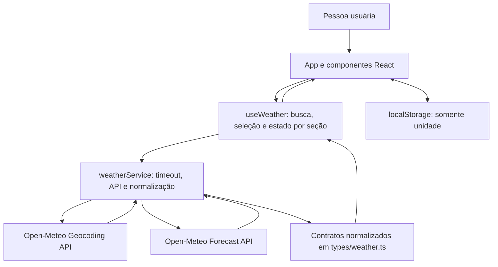
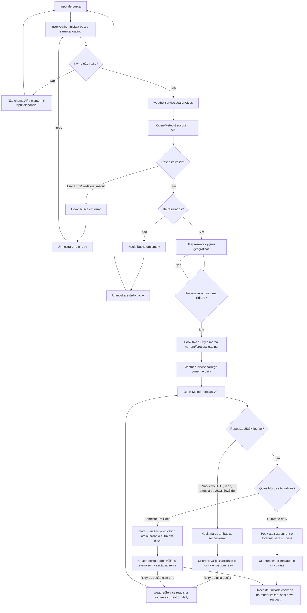

# Plano Técnico — Weather App

Este plano deriva de [`specs/weather-app-spec.md`](../specs/weather-app-spec.md) e orienta incrementos na implementação existente, sem reestruturar a aplicação. Requisitos são identificados por RF, RNF e AC; contratos e escolhas descritos como propostas são decisões técnicas a validar durante a implementação, não novos requisitos de produto.

## Architecture (Overview)

A arquitetura mantém quatro camadas com dependências direcionadas:

1. **Apresentação (`components/` e `App.tsx`):** `App.tsx` compõe a tela e conecta eventos; componentes recebem dados/estados por props, renderizam conteúdo acessível e emitem ações. Não chamam APIs nem implementam regras de negócio.
2. **Orquestração e estado (`hooks/`):** `useWeather` coordena busca, seleção explícita, carregamento independente de clima atual/previsão, concorrência e retry. Mantém estados da experiência, sem JSX ou detalhes de apresentação.
3. **Acesso a dados (`services/`):** `weatherService` monta requisições Open-Meteo, aplica timeout, trata falhas de transporte/HTTP e valida/normaliza respostas para os tipos de domínio. Não conhece React nem componentes.
4. **Funções puras (`lib/`):** conversão/formatação de temperatura, datas e códigos meteorológicos. Não acessa rede, armazenamento, DOM ou estado React.

`types/weather.ts` define contratos compartilhados, não uma camada com efeitos. O sentido permitido é `App/components → hooks → services`; as camadas podem importar `types` e funções de `lib`, mas `services` não importam React e `lib` não depende das outras camadas. Assim, UI, estado, integração externa e regras determinísticas podem ser alterados e testados isoladamente. A UI permanece em pt-BR e apresenta temperaturas normalizadas em Celsius na unidade escolhida.



Incremento-chave em relação ao comportamento atual: a busca apresenta opções e aguarda seleção explícita; o hook acompanha clima atual e previsão independentemente, preservando a seção que já carregou (RF1, RF2, RF8, RF9). A previsão e o clima continuam associados à mesma `City` selecionada.

## Tech Stack

| Tecnologia | Uso e justificativa |
| --- | --- |
| React 19.2 | Interface e estado local, mantendo os componentes existentes. |
| TypeScript 6 | Contratos estritos para respostas externas e modelo normalizado. |
| Vite 8 | Servidor de desenvolvimento e build já configurados. |
| Tailwind CSS 3.4 | Estilo responsivo integrado à aplicação atual. |
| Vitest 4, Testing Library e `user-event` | Testes de lógica e interação de componentes já adotados. |
| Playwright 1.61 | Fluxos E2E, responsividade, acessibilidade observável e medição de desempenho no Chromium. |
| Biome 2.5 | Lint e formatação existentes. |
| pnpm | Gerenciador e scripts definidos no projeto. |

Não é proposta a inclusão de dependências. As versões refletem a stack instalada no repositório, e não uma atualização de stack.

## Project Structure

Manter a estrutura atual de `src/` e adicionar componentes apenas onde a interação da spec exigir (por exemplo, uma lista selecionável de cidades):

```text
src/
  App.tsx                         # composição da tela e ligação entre camadas
  main.tsx                        # bootstrap do React
  components/                     # apresentação declarativa, sem fetch
    SearchBar.tsx                 # entrada e envio da consulta
    CityResults.tsx                # opções geográficas selecionáveis (novo, se necessário)
    CurrentWeather.tsx            # clima atual e campos indisponíveis
    ForecastList.tsx               # lista dos cinco dias
    ForecastCard.tsx               # apresentação de um dia
    UnitToggle.tsx                 # seleção da unidade
    states/                        # estados vazios, loading e erro por seção
  hooks/
    useWeather.ts                  # busca, seleção, estado por seção, concorrência e retry
  services/
    weatherService.ts              # endpoints, timeout, validação e mapeamento Open-Meteo
  types/
    weather.ts                     # City, CurrentWeather, ForecastDay, WeatherData, Unit
  lib/                             # funções puras, sem I/O
    format.ts                      # datas, unidades e rótulos de apresentação
    temperature.ts                 # conversão Celsius/Fahrenheit
    weatherCodes.ts                # códigos WMO para rótulos/ícones
  styles/
    index.css                      # estilos globais e diretivas Tailwind
```

**Fronteiras e testes:**

- `components/`: recebem props e chamam callbacks. Testar estados, conteúdo, teclado e acessibilidade com Testing Library; não mockar rede nesses testes.
- `hooks/`: são a única camada que combina ações da UI com chamadas de dados. Testar transições e concorrência com `renderHook` ou testes de integração da UI, mockando `weatherService` e controlando promessas.
- `services/`: são a única camada que executa `fetch`. Testar URLs, parâmetros, mapeamento, dados nulos/zero, timeout e falhas com `fetch` mockado.
- `lib/`: funções sem efeitos colaterais, testadas por entrada/saída determinística, sem mocks.
- `types/`: contratos compile-time; validação de payload externo acontece no service e é coberta por testes de respostas válidas, parciais e inválidas.

Os testes permanecem em `tests/unit/` e `tests/e2e/`, fora de `src/`. Não introduzir store global, roteador, camada de repositórios ou cache; persistir somente a unidade no navegador, conforme a spec.

## Data Model

Contratos TypeScript normalizados a partir das respostas Open-Meteo. Campos meteorológicos opcionais são representados por `null`; zero continua sendo um valor válido. Temperaturas são mantidas em Celsius e convertidas apenas para apresentação.

```ts
/** Unidade escolhida para exibição das temperaturas. */
export type Unit = 'celsius' | 'fahrenheit';

/** Resultado normalizado de uma opção da busca geográfica. */
export interface City {
  /** Identificador numérico retornado pelo Geocoding API. */
  id: number;
  /** Nome da cidade retornado pela busca. */
  name: string;
  /** País da cidade, ou null quando a API não o fornece. */
  country: string | null;
  /** Estado ou região administrativa, ou null quando ausente. */
  admin1: string | null;
  /** Latitude usada para consultar a previsão. */
  latitude: number;
  /** Longitude usada para consultar a previsão. */
  longitude: number;
}

/** Valores atuais normalizados; medidas ausentes permanecem null. */
export interface CurrentWeather {
  /** Horário local da observação, conforme retornado pela Forecast API. */
  time: string | null;
  /** Temperatura atual em graus Celsius (`current.temperature_2m`). */
  temperatureC: number | null;
  /** Código WMO da condição atual (`current.weather_code`). */
  weatherCode: number | null;
  /** Umidade relativa em porcentagem (`current.relative_humidity_2m`). */
  humidityPercent: number | null;
  /** Velocidade atual do vento em km/h (`current.wind_speed_10m`). */
  windSpeedKmh: number | null;
  /** Pressão de superfície em hPa (`current.surface_pressure`). */
  pressureHpa: number | null;
  /** Precipitação atual em mm (`current.precipitation`). */
  precipitationMm: number | null;
}

/** Valores normalizados de um dia local da previsão. */
export interface ForecastDay {
  /** Data local no formato ISO `YYYY-MM-DD` (`daily.time`). */
  date: string;
  /** Indica se a API forneceu ao menos uma métrica meteorológica para o dia. */
  available: boolean;
  /** Código WMO da condição diária (`daily.weather_code`). */
  weatherCode: number | null;
  /** Temperatura mínima em graus Celsius (`daily.temperature_2m_min`). */
  minTemperatureC: number | null;
  /** Temperatura máxima em graus Celsius (`daily.temperature_2m_max`). */
  maxTemperatureC: number | null;
  /** Volume total de precipitação do dia em mm (`daily.precipitation_sum`). */
  precipitationMm: number | null;
  /** Velocidade máxima do vento do dia em km/h (`daily.wind_speed_10m_max`). */
  windSpeedMaxKmh: number | null;
}

/** Estado de carregamento independente para uma seção meteorológica. */
export type SectionStatus = 'idle' | 'loading' | 'success' | 'error';

/** Dados, estado e erro de uma seção que pode carregar ou falhar isoladamente. */
export interface WeatherSection<T> {
  /** Estado atual da solicitação para esta seção. */
  status: SectionStatus;
  /** Dados válidos da seção, ou null antes de carregar/sem dados. */
  data: T | null;
  /** Mensagem localizada quando status é error; null nos demais estados. */
  error: string | null;
}

/** Agregado associado à cidade selecionada e às duas seções independentes. */
export interface WeatherData {
  /** Cidade selecionada para a qual os dados foram solicitados. */
  city: City;
  /** Fuso IANA local retornado pela Forecast API (`timezone`). */
  timezone: string;
  /** Seção das condições meteorológicas atuais. */
  current: WeatherSection<CurrentWeather>;
  /** Seção dos cinco dias de previsão local. */
  forecast: WeatherSection<ForecastDay[]>;
}
```

`City` normaliza os campos `id`, `name`, `country`, `admin1`, `latitude` e `longitude` do Geocoding API. `CurrentWeather` mapeia as métricas atuais da Forecast API; `ForecastDay` usa volume diário (`precipitation_sum`) e vento máximo (`wind_speed_10m_max`), não probabilidade de precipitação. Manter a data mesmo quando as métricas do dia não chegam: `available: false` e campos meteorológicos `null`. O estado da seção (`WeatherSection`) é independente dos campos ausentes, permitindo preservar clima atual quando a previsão falhar e vice-versa (RF8).

## Data Flow



1. A pessoa envia um nome não vazio. `useWeather` inicia busca geográfica e mostra carregamento; texto vazio não dispara chamada (RF1, RF7).
2. `weatherService.searchCities` codifica o nome e solicita até cinco resultados em pt-BR. A resposta é normalizada e exibida como opções; nenhum resultado é selecionado automaticamente. Se não houver opções, a UI apresenta o estado vazio.
3. Cada opção exibe nome, região/estado e país quando disponíveis. A seleção explícita define a localização corrente e inicia o carregamento de clima (RF2, RF9).
4. `weatherService` solicita inicialmente os dados atuais e diários juntos. Normaliza cada seção separadamente e retorna a cidade junto aos resultados, em Celsius, km/h e mm.
5. O hook atualiza cada seção conforme seu próprio sucesso/falha. Conteúdo válido de uma seção permanece na tela enquanto a outra carrega, falha ou é tentada novamente (RF8).
6. A UI formata datas em `pt-BR`, `DD/MM/AAAA`, usando o fuso local retornado pela API; converte e arredonda temperaturas conforme a unidade ativa. As demais métricas mantêm as unidades definidas no RF3/RF4.
7. Uma troca de unidade atualiza clima atual e previsão sem alterar a cidade nem refazer chamadas de clima. A preferência de unidade é salva no navegador; a cidade não é persistida (RF5, RF6 e Assumptions).

## External APIs

Usar Open-Meteo sem chave de usuário, conforme RNF5. URLs e parâmetros são propostas de implementação; conferir documentação e condições vigentes antes de cada release de produção.

### Geocoding API

- **URL:** `https://geocoding-api.open-meteo.com/v1/search`
- **Método:** `GET`
- **Parâmetros:** `name` é o nome da cidade codificado como query string; `count=5` limita sugestões; `language=pt` solicita nomes/localização em português quando disponíveis; `format=json` solicita JSON.
- **Exemplo de resposta resumida:**

```json
{
  "results": [
    {
      "id": 2267057,
      "name": "Lisboa",
      "latitude": 38.71667,
      "longitude": -9.13333,
      "country_code": "PT",
      "country": "Portugal",
      "admin1": "Lisboa"
    }
  ]
}
```

- **Mapeamento:** cada elemento de `results` vira um `City`: `id`, `name`, `country`, `admin1`, `latitude` e `longitude` são copiados para os campos homônimos. Como país ou região podem faltar em alguns resultados, normalizá-los para `null`. `results` ausente ou vazio vira resultado de busca vazio; HTTP não-2xx, erro de rede, timeout ou JSON inválido vira falha de busca, não estado vazio.

### Forecast API

- **URL:** `https://api.open-meteo.com/v1/forecast`
- **Método:** `GET`
- **Parâmetros de localização e período:** `latitude` e `longitude` da `City`; `timezone=auto` retorna datas e horários no fuso local da coordenada; `forecast_days=5` solicita hoje e os quatro dias seguintes.
- **Parâmetros de unidades:** `temperature_unit=celsius`, `wind_speed_unit=kmh`, `precipitation_unit=mm`. Os valores são normalizados nessas unidades; Fahrenheit é apenas conversão de apresentação.
- **Parâmetro `current`:** `temperature_2m,relative_humidity_2m,wind_speed_10m,surface_pressure,precipitation,weather_code`.
- **Parâmetro `daily`:** `weather_code,temperature_2m_max,temperature_2m_min,precipitation_sum,wind_speed_10m_max`.
- **Exemplo de resposta resumida:**

```json
{
  "latitude": 38.72,
  "longitude": -9.13,
  "timezone": "Europe/Lisbon",
  "current_units": {
    "time": "iso8601",
    "temperature_2m": "°C",
    "relative_humidity_2m": "%",
    "wind_speed_10m": "km/h",
    "surface_pressure": "hPa",
    "precipitation": "mm",
    "weather_code": "wmo code"
  },
  "current": {
    "time": "2026-11-05T12:00",
    "temperature_2m": 18.2,
    "relative_humidity_2m": 68,
    "wind_speed_10m": 12.4,
    "surface_pressure": 1016.2,
    "precipitation": 0,
    "weather_code": 2
  },
  "daily_units": {
    "time": "iso8601",
    "weather_code": "wmo code",
    "temperature_2m_max": "°C",
    "temperature_2m_min": "°C",
    "precipitation_sum": "mm",
    "wind_speed_10m_max": "km/h"
  },
  "daily": {
    "time": ["2026-11-05", "2026-11-06", "2026-11-07", "2026-11-08", "2026-11-09"],
    "weather_code": [2, 3, 61, 1, 0],
    "temperature_2m_max": [20.1, 19.4, 17.8, 18.6, 19.2],
    "temperature_2m_min": [14.2, 13.8, 12.1, 11.9, 12.5],
    "precipitation_sum": [0, 0.2, 4.8, 0, 0],
    "wind_speed_10m_max": [16.5, 18.1, 22.3, 13.4, 15.2]
  }
}
```

- **Mapeamento do clima atual:** `current.time` → `CurrentWeather.time`; `temperature_2m` → `temperatureC`; `weather_code` → `weatherCode`; `relative_humidity_2m` → `humidityPercent`; `wind_speed_10m` → `windSpeedKmh`; `surface_pressure` → `pressureHpa`; `precipitation` → `precipitationMm`.
- **Mapeamento diário:** `timezone` → `WeatherData.timezone`; para cada índice `i`, `daily.time[i]` → `ForecastDay.date`, `weather_code[i]` → `weatherCode`, `temperature_2m_min[i]` → `minTemperatureC`, `temperature_2m_max[i]` → `maxTemperatureC`, `precipitation_sum[i]` → `precipitationMm` e `wind_speed_10m_max[i]` → `windSpeedMaxKmh`. O `available` derivado é `true` quando ao menos uma métrica meteorológica do dia não é `null`; zero é dado disponível, não ausência.
- **Agregação:** a `City` selecionada acompanha a resposta; `current` e `forecast` são encapsulados em `WeatherSection` independentes. Campos opcionais ausentes ou nulos viram `null`, nunca zero. Falha de transporte ou HTTP afeta a solicitação inteira; bloco `current`/`daily` ausente ou inválido afeta apenas a respectiva seção e habilita retry somente nela.

Para reduzir chamadas, o primeiro carregamento pede `current` e `daily` juntos e interpreta as partes separadamente, sem exigir que ambas existam para aproveitar uma resposta válida. Se somente uma seção faltar ou falhar na validação, retry envia uma chamada específica com apenas `current` ou `daily`, atualizando só essa seção. Se a requisição combinada falhar globalmente, ambas ficam em erro e podem ser tentadas separadamente. A API entrega campos meteorológicos no mesmo endpoint, não serviços independentes: uma resposta HTTP inválida no pedido combinado não permite inferir sucesso parcial.

Referências: [Geocoding API](https://open-meteo.com/en/docs/geocoding-api), [Forecast API](https://open-meteo.com/en/docs) e [termos da Open-Meteo](https://open-meteo.com/en/terms). A atribuição visível com link à fonte é requisito (AC-RNF5-01); verificar termos, limites de uso e crédito vigente antes de cada release (RNF5).

## State Management

O estado vive localmente, sem store global:

- `useWeather` é fonte de verdade para consulta, lista de cidades, seleção, clima atual e previsão. Busca e cada seção meteorológica têm ciclos de vida independentes.
- `App` mantém a unidade de exibição e a inicializa a partir de `localStorage`; componentes recebem dados/estados por props e emitem ações por callbacks.
- A busca usa `idle | loading | success | error | empty`: inicia em `idle`; envio válido muda para `loading`; resultados selecionáveis levam a `success`; lista vazia leva a `empty`; falha de rede/API/timeout ou payload inválido leva a `error`. Busca vazia não muda o estado nem envia request.
- Clima atual e previsão usam, cada um, `idle | loading | success | error`. Não têm `empty`: dados meteorológicos ausentes são representados por campos `null`/dia indisponível, não por estado vazio.
- A cidade só é selecionada após ação explícita. Ao selecioná-la, ambas as seções passam a `loading`; cada uma muda para `success` ou `error` independentemente e preserva seus dados válidos durante a atualização/retry da outra.
- Cada busca/seleção tem identidade de request; cancelar ou ignorar respostas antigas evita que resultados atrasados substituam a busca ou cidade mais recente (AC-RF1-04, AC-RF9-02).
- O retry da busca repete Geocoding e volta a `loading`; retry meteorológico recebe `current` ou `forecast`, altera somente essa seção para `loading` e não refaz a seção já válida.

`CurrentWeather` e `ForecastDay` mantêm temperaturas em Celsius como unidade canônica. A renderização deriva o número conforme `Unit`, aplica `Math.round` ao resultado e inclui o símbolo da unidade; conversão equivalente a `F = C × 9/5 + 32`. Exemplo: `20 °C → 68 °F`. O cálculo é local e não chama `weatherService`, não altera o dado original nem dispara novo request (AC-RF5-01–05). A unidade escolhida é salva localmente; valor ausente/inválido usa Celsius (AC-RF6-01). Falha de leitura/escrita de `localStorage` não impede a consulta; usar Celsius durante a sessão como fallback.

## Error Handling

Erros de busca e de cada seção são tipados/associados à origem e apresentados em pt-BR. `empty` é reservado a geocoding bem-sucedido sem resultados; falhas nunca são convertidas em vazio.

| Categoria | Detecção e estado | Comportamento/recuperação |
| --- | --- | --- |
| Entrada vazia | Após `trim`, string vazia; busca permanece no estado atual. | Não chamar API; manter input disponível para correção (AC-RF1-02). |
| Geocoding sem resultados | HTTP bem-sucedido com `results` ausente ou vazio; busca → `empty`. | Informar que não encontrou cidades e permitir nova consulta, sem mensagem de erro (AC-RF7-03). |
| Rede/CORS | `fetch` rejeita ou conexão é interrompida; busca ou seções solicitadas → `error`. | Encerrar loading, mostrar mensagem de rede em pt-BR e retry para a origem/seção afetada. Preservar resultados/dados já válidos quando aplicável. |
| Erro HTTP/API | Status não-2xx ou objeto de erro do provedor; origem/seções solicitadas → `error`. | Distinguir de `empty`; mostrar mensagem compreensível e retry. Não expor payload técnico da API como mensagem principal. |
| Timeout | `AbortController` cancela a solicitação após 10 s; origem/seção → `error`. | Encerrar loading, informar expiração e oferecer retry (AC-RF8-02). |
| Resposta malformada | JSON inválido, arrays `daily` de comprimentos diferentes ou `daily.time` com quantidade diferente de cinco datas; seção afetada → `error`. | Não fabricar valores/datas; preservar a outra seção válida e permitir retry local (AC-RF4-01, AC-RF8-01, AC-RF8-04/05). Se as cinco datas existem, mas as métricas de um dia estão ausentes, preservar a data e marcar o dia indisponível. JSON ilegível no nível da resposta combinada afeta ambas as seções. |
| Resposta parcial | Resposta válida, mas bloco `current` ou `daily` ausente/incompleto; seção presente → `success`, ausente → `error`. | Exibir seção válida; marcar campos meteorológicos ausentes como `null`/“Não disponível”; manter datas identificáveis e indicar previsão indisponível se faltar o dia inteiro. Retry apenas da seção com falha (AC-RF3-02, AC-RF4-03, AC-RF8-04/05). |
| Campo individual ausente | Valor da métrica é `null` ou não veio, sem invalidar a seção. | Normalizar para `null`, renderizar “Não disponível” e preservar `0` como valor válido (AC-RF3-02/03, AC-RF4-03). |
| Resposta obsoleta | ID do request não corresponde à busca/cidade corrente. | Descartar a resposta sem alterar seleção, resultados ou dados atuais (AC-RF1-04, AC-RF9-02). |
| Retry bem-sucedido | Request repetido retorna payload válido para a origem/seção. | Substituir erro por dados e `success`, sem limpar conteúdo válido das outras seções (AC-RF8-03/05). |

Uma falha de transporte na chamada combinada afeta ambas as seções; sucesso parcial de conteúdo é tratado por bloco. Não inferir sucesso quando a resposta inteira não pode ser lida. Isso mantém o comportamento coerente com os limites do endpoint Open-Meteo e com RF8.

## Testing Strategy

Estender `tests/unit/` com Vitest e Testing Library e `tests/e2e/` com Playwright. Usar respostas Open-Meteo simuladas e valores controlados para não depender de rede real nos testes funcionais; cobrir os ACs observáveis, não detalhes internos da implementação.

Gates obrigatórios antes de concluir tarefas de código/teste: `pnpm lint`, `pnpm build` e `pnpm test`. O conjunto E2E planejado é executado com `pnpm test:e2e`; a matriz de compatibilidade descrita abaixo é gate adicional de release, conforme RNF7.

### Vitest e Testing Library

| Área | Cobertura e ACs |
| --- | --- |
| Funções puras — `temperature.test.ts`, `format.test.ts`, `weatherCodes.test.ts` | Testar conversão C/F, exemplos 20 °C ↔ 68 °F, arredondamento, símbolos, datas `DD/MM/AAAA`, nomes de dias pt-BR, códigos meteorológicos conhecidos/desconhecidos; sem mocks. AC-RF5-01/02/04, AC-RF10-02. |
| Services — `weatherService.test.ts` | Mockar `fetch`; validar URLs/parâmetros, encoding de acentos, mapeamento de ambas as APIs, `null` versus zero, `precipitation_sum`, timeout, HTTP/rede/JSON inválido, payload parcial e requests de retry por seção. AC-RF1-02/03, AC-RF3-02/03, AC-RF4-01/02/03/05, AC-RF8-01/02; RNF4/RNF5. |
| Componentes de busca — `SearchBar`, `CityResults`, `UnitToggle` | Testing Library: `idle` e input vazio; `loading` visível/desabilitações necessárias; `empty` sem opções; `success` com resultados selecionáveis e contexto geográfico; `error`/retry; teclado, labels e unidade ativa. AC-RF1-01/02, AC-RF2-01/02, AC-RF5-03, AC-RF7-01/02/03/05; AC-RNF3-01/02. |
| Componentes meteorológicos — `CurrentWeather`, `ForecastList`, `ForecastCard` e estados | Renderizar `idle`, `loading`, `success` e `error` independentemente para current/forecast; campos `null` como “Não disponível”; zero como dado válido; cinco dias em ordem e dia indisponível preservando data; retry local sem remover seção válida. AC-RF3-01/02/03, AC-RF4-01/02/03/04/05, AC-RF7-04/05, AC-RF8-04/05. |
| Hook/App — `App.test.tsx` e `useWeather` | Mockar service e usar promessas controladas: transições de estado, seleção explícita, busca antiga ignorada, troca de cidade, partial failure/retry, unidade salva após reload, default Celsius e nenhuma cidade persistida. AC-RF1-04, AC-RF5-01/02/03/05, AC-RF6-01, AC-RF7-01–05, AC-RF8-03–05, AC-RF9-01/02. |

### Playwright

| Cenário | Cobertura e ACs |
| --- | --- |
| Fluxo E2E desktop | Busca, escolha explícita entre homônimos, current+forecast, troca/persistência da unidade, vazio, falha e retry, timeout, respostas parciais, atribuição Open-Meteo e idioma. AC-RF1-01/03/04, AC-RF2-01/02, AC-RF3-01, AC-RF4-01/04, AC-RF5-01/05, AC-RF7-01–05, AC-RF8-01–05, AC-RF9-01/02, AC-RF10-01/02, AC-RNF5-01. |
| Fluxo E2E mobile | Executar busca, seleção, leitura da previsão e retry em viewports de 320 px e 375 px; verificar que controles e conteúdo continuam acessíveis e sem sobreposição/rolagem horizontal. AC-RNF2-01, AC-RNF3-01/02. |
| Acessibilidade visual | Verificar foco por teclado e nomes/estados semânticos; medir contraste de texto comum/grande com ferramenta de auditoria apropriada. AC-RNF3-01/02/03. |
| Compatibilidade RNF7 — gate de release | Antes de cada release, executar e registrar o fluxo principal nas versões estáveis atual e anterior de Chrome, Edge, Firefox e Safari; incluir Safari em iOS e Chrome em Android em dispositivos reais. Playwright Chromium/Firefox/WebKit é cobertura automática complementar, não substitui Safari/Chrome reais. Bloquear release se algum alvo falhar. AC-RNF7-01. |

**Reprodução de desempenho no GitHub Actions:** propor um cenário Playwright Chromium dedicado executado em `ubuntu-latest`, viewport 1280 × 720, cache desabilitado. Fazer três navegações independentes em contextos limpos e medir, em cada uma, navegação até o campo de busca visível e habilitado; ordenar as três medições e exigir mediana ≤ 2 s (AC-RNF1-01). Em Chromium, desabilitar cache via CDP e emular conexão com latência de 50 ms e throughput de download/upload de 1.25 MB/s (10 Mbps); não incluir o tempo da API externa na métrica de inicialização. Separadamente medir do envio da busca até a renderização do indicador e exigir ≤ 100 ms (AC-RNF1-02), usando API interceptada para tornar o estado pendente observável. Manter esse cenário no workflow de CI sem depender da fonte pública; revisar sua estabilidade no runner antes de tratar a medição como gate. O projeto Playwright existente já define Chromium e servidor Vite, portanto a proposta é adicionar o cenário/configuração necessária, não substituir a configuração inteira.

O gate RNF7 é uma validação obrigatória antes de cada release, não uma opção entre CI e verificação manual. Registrar navegador, versão, dispositivo, resultado do fluxo e falhas encontradas; Chromium sozinho e emulação mobile não comprovam Safari iOS nem Chrome Android.

## Risks & Trade-offs

| Decisão | Alternativas consideradas | Escolha e trade-off |
| --- | --- | --- |
| Estado local em `useWeather`/`App` | Redux/Zustand ou Context global. | Manter estado local: menos dependências e complexidade para uma única tela; adicionar store apenas se surgir compartilhamento entre fluxos/rotas. |
| Busca com seleção explícita | Selecionar automaticamente o primeiro geocoding result. | Seleção explícita reduz erro em cidades homônimas e atende RF2, ao custo de uma ação adicional do usuário. |
| Clima atual e previsão em estados separados | Um único status agregado all-or-nothing. | Estados independentes preservam dados válidos e habilitam retry parcial, mas exigem mais estados e testes de combinação. |
| Primeira requisição `current` + `daily` combinada | Duas requisições independentes sempre. | Uma chamada reduz tráfego no sucesso comum; retry pode ser específico, mas falha HTTP global afeta as duas seções. |
| Armazenar temperaturas em Celsius e converter na UI | Consultar novamente a API por unidade ou armazenar cópias em °C e °F. | Um único valor canônico evita drift e requests; conversão/rounding em render é simples, mas deve ser centralizada e testada. |
| Persistir unidade em `localStorage` | Estado somente em memória ou preferência no servidor. | Persistência local atende RF5 sem conta/servidor; pode falhar em modo restrito, então fallback usa Celsius e mantém o app funcional. |
| Representar ausência como `null` | Converter ausência para zero ou tornar todo o payload inválido. | `null` distingue indisponibilidade de zero real e permite resposta parcial; componentes precisam renderizar estado indisponível. |
| `fetch` + `AbortController` para timeout | Adicionar cliente HTTP/dependência de retry. | Reutilizar APIs nativas reduz dependências e cobre timeout simples; backoff/retry automático fica fora do plano, com retry manual explícito na UI. |
| Open-Meteo real apenas fora dos testes funcionais | Usar API real em unit/E2E. | Mocks tornam resultados determinísticos e sem dependência de rede; não detectam mudanças reais no provedor, mitigadas por validação de payload e checagem de termos/limites antes do release. |
| Mediana de três medições em CI | Uma única medição ou média de muitas execuções. | Mediana reduz sensibilidade a um outlier sem alongar muito a suíte; runner compartilhado ainda pode introduzir ruído e requer monitoramento. |

Não estão no escopo cache/offline, histórico, favoritos, geolocalização, autenticação ou persistência de cidade, conforme exclusões e premissas da especificação.